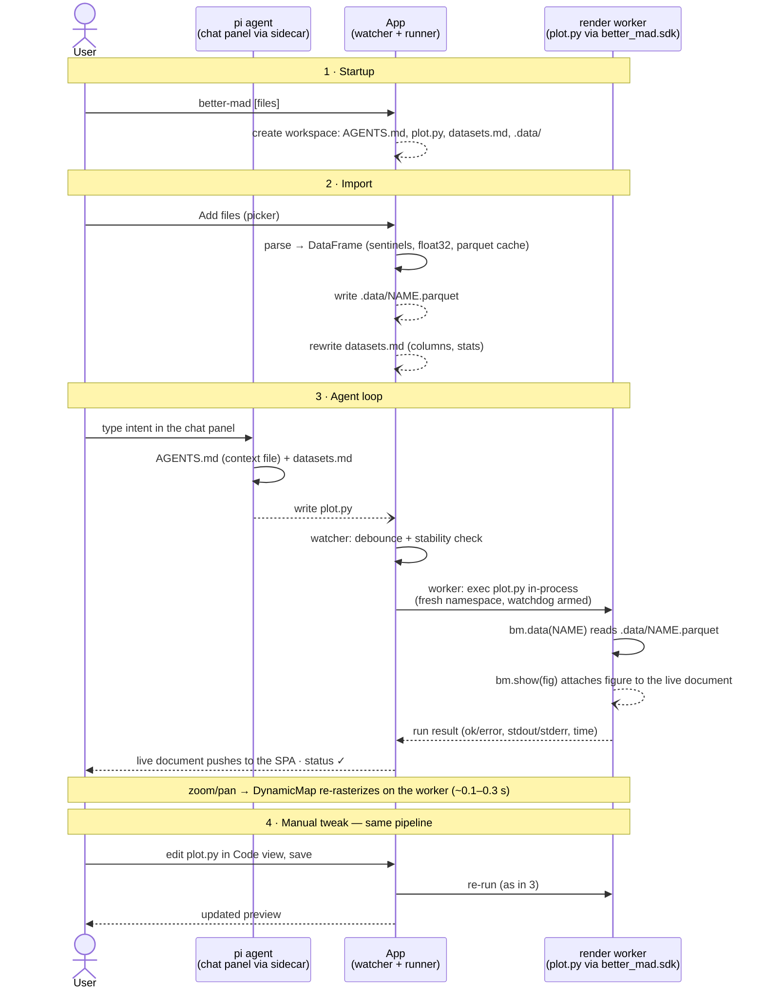

# better-mad — Design (v2: agent-driven plotting)

An LLM-agent-driven instrument for visualizing seismic attributes: load large tabular
text files, tell an agent what you want to see, get back a plotting **script** plus an
**interactive preview** — then refine either by hand or through the agent.

The v1 design (declarative plotting UI, milestones M0–M4 implemented) is preserved on
the `archive/codebase` branch.

---

## 1. Decisions (resolved)

| # | Topic | Decision |
|---|-------|----------|
| 1 | Product direction | **Instrument, not omnibus**: no attempt to menu-ify every plot type. Users get a programmable surface (agent + editable code) they can tailor |
| 2 | Agent integration | **Embedded chat panel** (left pane) driven by the pi SDK inside a **Node sidecar process** spawned by the app (the pwb pattern: SSE/HTTP chat transport over a persistent `AgentSession`). Models resolve from the user's existing `~/.pi/agent` providers — no new API keys. **2026-11-02 update:** replaces the original v2 decision (embedded pty terminal, any harness); the pty terminal moves to future work (§11). External harnesses still work from a normal terminal — coupling stays filesystem-only |
| 3 | Agent ↔ app protocol | **Filesystem**. The agent edits the plot script; the app watches the file and re-runs it. No sockets, no proprietary protocol |
| 4 | Plotting stack | **HoloViews + Datashader** rendered on a **live bokeh-server document** in an isolated **render worker** process. **2026-11-02:** Panel dropped after M2 — the shell is a web-native **React/TS SPA** with a **FastAPI** hub (pwb pattern). Handles 1–2M-row files natively; zoom re-rasterizes server-side |
| 5 | Code execution | `plot.py` executes **inside the render worker** (fresh namespace per run, watchdog timeout, kill/restart on fatal). Never inside the hub. **2026-11-02:** replaces the M1 subprocess-per-run + pickle transport, which forced static rasters |
| 6 | Script model | One active script (`plot.py`) per workspace in v2. Multiple scripts/tabs: future work |
| 7 | Code editing | Center pane toggles **Preview ⟷ Code**; the editor edits the same `plot.py` the agent writes. External changes reload the editor |
| 8 | Data loading | Reuse the v1 core loader from `archive/codebase`: delimiter detect, hostile-header sanitization, configurable null sentinels, float32, parquet cache |
| 9 | Agent knowledge | Workspace ships an **`AGENTS.md` skill file + auto-generated dataset manifest** so even small local models can produce correct plots by adapting recipes |
| 10 | Sandbox | **None.** Scripts run with the user's own privileges — same trust model as running the agent in a normal terminal. Documented, not hidden |
| 11 | Distribution | Unchanged in spirit: CLI starts the **hub** (uvicorn) on localhost — it spawns the render worker + chat sidecar, serves the SPA, and opens the system browser |

---

## 2. Concept

Instead of building the perfect plotting UI for every case, better-mad provides an
instrument the user tailors:

```
import files → describe intent to the agent → agent writes plot.py
            → render worker runs it → live interactive preview
            → adjust: edit the code by hand, or talk to the agent
            → zoom/pan re-rasterizes server-side (datashader, live document)
```

- The **agent does the composition**: picking columns, choosing plot types, styling,
  datashader usage — all the things v1 expressed as menus.
- The **code is the configuration**: fully visible, fully editable, version-controllable.
- The **app provides the substrate**: robust loading of hostile 1–2M-row files, a safe
  runner, a live interactive preview, and skill material that makes small models capable.

## 3. Layout

```
┌──────────────────────────────────────────────────────────────────┐
│ Header: workspace · [Run] [Auto-run ✓] · run status · model       │
├────────────────┬─────────────────────────────┬───────────────────┤
│ Agent chat     │  [Preview | Code] toggle    │ Files             │
│ (pi, streamed  │  • live interactive plot    │ ▸ file_a 708k rows│
│  replies +     │  • or editable plot.py      │   columns + stats │
│  tool notes;   │                             │ ▸ file_b …        │
│  Stop / New)   │                             │ [Add files…]      │
└────────────────┴─────────────────────────────┴───────────────────┘
```

- The shell is a **web-native SPA (React/TS + Vite)** served by the Python hub; the
  plot pane embeds the render worker's live bokeh document (§5). Three panes:
  (§9.1). The agent edits `plot.py` with its built-in file tools; replies stream in
  with tool notes ("⚙ editing plot.py…"). One in-flight turn at a time; Stop button
  aborts, New-chat rotates the session. History persists per workspace.
- **Center — preview/code**: the rendered figure (HoloViews pane) or a code editor bound
  to `plot.py`. Toggle is instant; both stay alive.
- **Right — files**: open datasets with columns (original display names + sanitized
  names), row counts, quick stats; import entry point.

## 4. Workspace & agent protocol

The app owns a **workspace directory** (created per session; path shown in header):

```
workspace/
├── AGENTS.md        # skill file: SDK reference, conventions, recipes, pitfalls
├── datasets.md      # auto-generated manifest of loaded data (names, columns, stats)
├── plot.py          # the one active plotting script (agent- and user-edited)
├── .data/           # per-dataset parquet snapshots + .json sidecars (source path,
                     # parser settings) so a reopened workspace can rehydrate
└── .chat/           # sidecar-hosted pi session files (JSONL) — chat history survives
                     # app restarts and workspace reopenings
```

- The agent session runs with **cwd = workspace**; pi natively loads `AGENTS.md` from
  its cwd as a context file, so the skill material reaches the model with no extra
  plumbing. An external harness opened in a terminal at the workspace works the same
  way — no per-harness integration needed.
- `datasets.md` is regenerated on every import/re-parse: file names, row counts,
  original + sanitized column names, dtype, min/max/NaN%. This is what lets a small
  model know the data without reading 121 MB files.
- A **file watcher** (debounced ~0.5 s) detects changes to `plot.py` from any writer
  (agent, user's editor, external editor) and triggers a run when auto-run is on.
- Manual **Run** button always available; auto-run is a toggle.

### 4.1 Interaction sequence



Failure branch of step 3: if `plot.py` raises, the run fails **inside the worker** —
the worker survives, the document keeps its last good roots (staleness badge) and the
error tail renders as a banner (§5, UX §6). If the script hangs or dies fatally, the
watchdog kills the worker; the hub restarts it, **re-executes the last-good
script** (hub-stored, known-safe), and never auto-re-runs the failing script
(no crash loops). No write to `plot.py` happens on failure — only the user or
the agent edits the script.

### 4.2 File ledger

Who touches which workspace file, and when:

| File | Written by | Read by | Lifecycle |
|------|-----------|---------|-----------|
| `AGENTS.md` | app at workspace creation (never overwritten) | pi agent session (pi context-file convention); any external harness | static within a version |
| `datasets.md` | app, on every import/re-parse | agent harness, user | fully regenerated each time |
| `plot.py` | pi agent (chat, via its built-in file tools); user via the code editor (or any external editor) | runner (executes), code editor | persists in the workspace |
| `.data/NAME.parquet` (+ `.json` sidecar) | app, on import | SDK `bm.data()` reads the parquet in the subprocess; app reads the sidecar on workspace reopen (rehydration) | one per open dataset |
| `.chat/*.jsonl` | sidecar (SessionManager) | sidecar (history replay); app never reads them | one per workspace, rotates on New chat |
| doc snapshot (JSON, hub memory) | worker, after each successful run | hub — restores it after a worker restart | one per workspace |

Note the asymmetry that keeps the design simple: the app only ever writes *data and
knowledge* files; the only file the agent/user writes is `plot.py`; the only file the
app executes is `plot.py`. The app never parses agent actions — the chat transport
(§9.1) carries text and tool telemetry for display only; **`plot.py` edits remain the
sole coupling between agent and app**.


## 5. SDK & render worker

Scripts run inside an isolated **render worker** process — a bokeh server hosting one
live document per workspace — and attach figures through the same tiny SDK:

```python
import holoviews as hv

import better_mad.sdk as bm

df = bm.data("file_a")  # DataFrame from the app's loaded datasets
print(bm.list_data())  # available dataset names + shapes

pts = hv.Points(df, ["XCORD_MIDPT", "YCORD_MIDPT"], vdims=["TR_DOMFREQ"])
bm.show(pts)  # attaches the figure to the worker's live document
```

- `bm.data(name)` returns the parsed DataFrame (from the parquet cache — instant).
  **The SDK's public API is unchanged from M1**; only `show()`'s implementation moved
  from pickle-to-file to attach-to-document.
- `bm.show(obj)` renders in-process and attaches to the worker's bokeh document.
  Accepted: `hv.Element`, `Overlay`, `Layout`, `NdLayout`; last `show()` wins. Because
  everything stays in one process: **DynamicMaps stay dynamic** (`rasterize()`/
  `datashade()` re-rasterize on zoom via bokeh range callbacks) and `.opts()` apply
  natively — the M2 pickle-era hacks (opts capture/re-apply, DynamicMap
  materialization) are gone. Rendering is eager, so invalid opts raise **at run time**
  and become clean error results instead of lazy render-time surprises.
- **Worker shape**: a Python process running a programmatic `bokeh.server.Server`
  (single shared session document) plus a minimal control API on the same port via
  `extra_patterns`: `POST /run` (exec `plot.py`), `GET /health`, `GET /doc.json`
  (snapshot for hub-side last-good retention). Runs execute on the server's IOLoop
  thread in a **fresh module namespace**; stdout/stderr are captured; a **watchdog**
  (default 60 s, configurable) kills the worker on hangs.
- **Lifecycle & failure semantics** (owned by the hub, §9): script exception → error
  result, document untouched (last good roots + staleness badge). Fatal/hang → kill,
  restart worker, **re-execute the last-good script** (kept by the hub — it is known-good,
  so no crash loop; the failing script is never auto-re-run). Restoring from a
  document snapshot is *not* possible in bokeh 3.x: `serialize_json(doc.to_json())`
  is structural only — ndarray buffers stay out of the JSON, so it can't be
  `from_json_string`-restored; the snapshot serves debugging/inspection instead.
- **Isolation trade-off** (accepted): in-process exec loses per-run OS isolation — a
  script can pollute module/global state or leak memory. Mitigations: fresh namespace
  per run, recycle the worker after runs that raised, hard cap on consecutive runs
  (recycle anyway). The trust model is unchanged: user privileges, no sandbox (§10);
  a fatal script can only cost its own worker.
- The worker is core-adjacent, headless and pytest-covered (spawn it, run scripts,
  assert on the document); the SPA's plot pane is a thin consumer that embeds the
  live document.

## 6. Input data (carried over from v1)

All v1 loader requirements stay — they are exactly why this tool exists:

- Whitespace/comma/tab-delimited text, first row header, no extensions, hostile names
  (`TR.DOMFREQ`, `3DT_SEC_ORD_CELCTR`) → sanitized internal names, originals kept for
  display. Ragged/comment rows tolerated. Never crash the load.
- Configurable null sentinels per file (numeric or string tokens); **0 is always valid**.
- float32 attributes / float64 coordinates; parquet cache in `~/.cache/better-mad/`
  keyed by path+mtime+size+settings.
- Target: 1–2M rows × several files open. (Measured in v1: 708k first load ≈11 s,
  cache reload ≈0.05 s, 31 MB RAM/file.)

The loader, column registry, and cache are restored from `archive/codebase` (they are
UI-free and fully tested).

## 7. Preview interactivity

The preview is a **live bokeh document** — interactions are server-real, not baked
into a static image:

- **Pan / wheel-zoom / box-zoom / reset** via the standard Bokeh toolbar; on
  datashaded plots, every range change re-rasterizes on the worker (~0.1–0.3 s for
  ~700k points locally) and streams the new raster back.
- **Box & lasso selection** enabled on the toolbar.
- Vector hover and linked selection beyond the toolbar are **script-side**: the agent or
  user adds `hv.streams`/`HoverTool` in `plot.py`; AGENTS.md ships recipes. Under the
  live document these update interactively (no re-run needed).
- **Datashader is script-side too** (recipes: `rasterize(...)` for >~100k points,
  mean-of-z aggregation, `cnorm`/clim handling). The skill file encodes the v1 lessons
  (rasterize aggregates the first vdim, etc.).

## 8. Agent skills & small-model support

A core bet of v2: with good skills, even a small local model produces good plots —
and the chat plan strengthens it: the session loads `AGENTS.md` as a context file
with **guaranteed pickup** (no reliance on the harness or the user remembering to
read it).

- `AGENTS.md` in the workspace: SDK reference (copy-pasteable), hard rules (always read
  `datasets.md`, always end with `bm.show()`), and **recipes** for the seismic staples:
  colored scatter map (UTM, equal aspect), crossplot, histogram, line/CMP gather,
  datashader variants, percentile-clipped color scales.
- Every recipe is a complete runnable script, not pseudocode.
- Known-gotchas section carries the v1 post-mortems (pandas 3.x parsing, rasterize
  vdim trap, sizing policies) so models don't rediscover them.
- `datasets.md` keeps per-column stats so the model can pick sane clims/bins without
  loading data.

## 9. Tech stack & architecture

**2026-11-02: Panel dropped.** The M2 app layer fought the framework (15+ documented
gotchas, static-raster limitation) and capped look & feel. The rewrite keeps the
entire headless core and replaces only the thin app layer. Process layout (all
localhost; the hub owns every spawn):

```
┌──────────┐  REST/SSE   ┌────────────┐  control API  ┌────────────────┐
│ SPA      │◄───────────►│ Hub        │◄─────────────►│ Render worker  │
│ React/TS │  embeds doc │ FastAPI    │  doc snapshot │ bokeh server   │
│ (Vite)   │◄────────────┼────────────┼──────────────►│ (plot.py exec) │
└──────────┘  WebSocket  │  + proxy   │  SSE proxy    └────────────────┘
     ▲        (live doc)  │  /api/chat │◄─────────────►┌────────────────┐
     └───────────────────►│            │   chat API    │ Chat sidecar   │
                        └────────────┘               │ Node, pi SDK   │
                                                     └────────────────┘
```

- **Hub** (`better_mad/hub/`, Python, FastAPI + uvicorn): owns the workspace (core),
  file import, the `plot.py` watcher, run orchestration, worker + sidecar lifecycle,
  chat proxying (single origin — no CORS), and serves the built SPA. Endpoints:
  files/import · files list · plot.py get/put · run · status · events (SSE:
  run results, worker lifecycle, embed epoch) · plot/embed (worker URL + session id).
- **Render worker** (`better_mad/worker/`): see §5. Headless, pytest-covered.
- **Chat sidecar** (`sidecar/`, Node/TypeScript): see §9.1.
- **SPA** (`web/`, React + TypeScript + Vite): three-pane shell (chat | plot/code |
  files), CodeMirror 6 editor, plot pane embedding the live document via
  `bokeh.embed.server_document`, chat pane (React port of pwb's client), files pane.
  Dev mode: Vite dev server proxies `/api` → hub (pwb pattern); prod: hub serves
  `web/dist`.
- **Core** (`better_mad/core/`, unchanged rule): loading, workspace model, manifest
  generation, script execution semantics, sidecar lifecycle — headless, pytest-covered.
  No framework imports in core (worker imports bokeh/hv; hub imports fastapi; neither
  leaks into loading/workspace/runner logic).
- Python ≥ 3.11 (**uv**, ruff, ty); **Node ≥ 20** (sidecar + web tooling); deps add
  `fastapi`, `uvicorn`, `httpx`.
- CLI: `better-mad [files...]` → workspace + hub + browser, as before.

### 9.1 Agent chat sidecar (Node)

The pi SDK is Node-only, so the hub spawns a small **Node sidecar process** that owns
the agent session — the pattern proven by the pwb project (SSE/HTTP chat transport
over `createAgentSession`). Unchanged from the 2026-11-02 chat decision except the UI
renderer (React pane instead of `pn.chat`):

- **Transport contract** (localhost only, derived from pwb's `chat.ts`; the hub
  proxies it under `/api/chat/*` so the SPA sees one origin): `GET /events`
  (SSE with heartbeat; `text_delta`, `agent_start/end`, `tool_execution_start/end`,
  `stopped`, `reset`, `error` payloads), `POST /send` (202; one in-flight turn, else
  409), `POST /stop` (`session.abort()`), `POST /new` (fresh session file; old file
  stays), `GET /history` (replay for UI reload), `GET /health`.
- **Session config**: `createAgentSession({ cwd: workspace, … })` with built-in file
  tools **enabled** (they *are* the agent↔app protocol), context files **enabled**
  (`AGENTS.md` auto-loads), no extensions/prompt-templates/themes, sessions persisted
  to `workspace/.chat/` via `SessionManager` (resume most recent on boot). A watchdog
  aborts hung provider calls (pwb default: 5 min) so a dead turn can never wedge the
  busy flag.
- **Model**: resolved from the user's `~/.pi/agent` provider config via `ModelRuntime`
  (pwb's `resolveModel("provider/model")`); a `--model` CLI flag overrides; the
  resolved model id shows in the app header.
- **Lifecycle**: owned by the hub alongside the worker — spawn, health-poll,
  restart-once-on-crash, then degrade the chat pane to a banner (plot/editor/files
  keep working — they never depend on the agent).
- The sidecar carries **no better-mad logic** — no custom tools in v2 (§11). It is a
  thin pi-session host; the workspace filesystem stays the only protocol.

## 10. Security model

- Generated scripts run **unsandboxed**, with the user's privileges, on the user's
  machine — identical to running the agent in a plain terminal. The app does not fetch,
  exec, or auto-run anything from the network; execution only follows edits to `plot.py`.
  A fatal script can only cost its own worker process (kill → restart, §5).
- The agent itself runs in the Node sidecar with the same user privileges and the same
  built-in file tools it would have in a terminal. Chat text goes to whichever provider
  the user configured in `~/.pi/agent` — the app adds no new network parties and stores
  no credentials (the sidecar reuses pi's auth store).
- The trust boundary is the user's choice of model/provider in their pi config;
  better-mad stays out of that decision.
- Documented plainly in README and first-run hint.

## 11. Future work (explicitly not v2, ordered)

1. Multiple scripts / script tabs, script history & diff
2. Embedded pty terminal as an alternative agent surface for non-pi harnesses
   (claude-code, codex, aider…) — the original v2 decision, demoted 2026-11-02 when
   the pi chat panel (§9.1) replaced it; same workspace protocol either way
3. Selection → data workflows: export selected points to CSV, feed selection back to
   the agent ("plot only these")
4. Session persistence: files + parser settings + `plot.py` + workspace path
5. PNG export button (HoloViews matplotlib backend, as planned in v1)
6. Hover/tap inspection helpers as SDK/recipe extensions
7. Cross-file joins/expressions (if still needed once the agent can do them in code)
8. AppImage packaging
9. Gridding/interpolation for map views (still explicitly out by default)
10. Custom agent tools beyond the built-ins (e.g. a `run_script` trigger, dataset
    introspection tools) — the filesystem protocol needs none of them
11. Client-side WebGL layer for instant hover/selection on ≤~2M points (hybrid: the
    worker ships binary column buffers; datashader raster stays for aggregation
    quality) — only if live re-rasterization latency ever feels insufficient
12. Worker recycling heuristics beyond run-failure (memory ceiling, consecutive-run
    cap) if leaks prove real in practice
